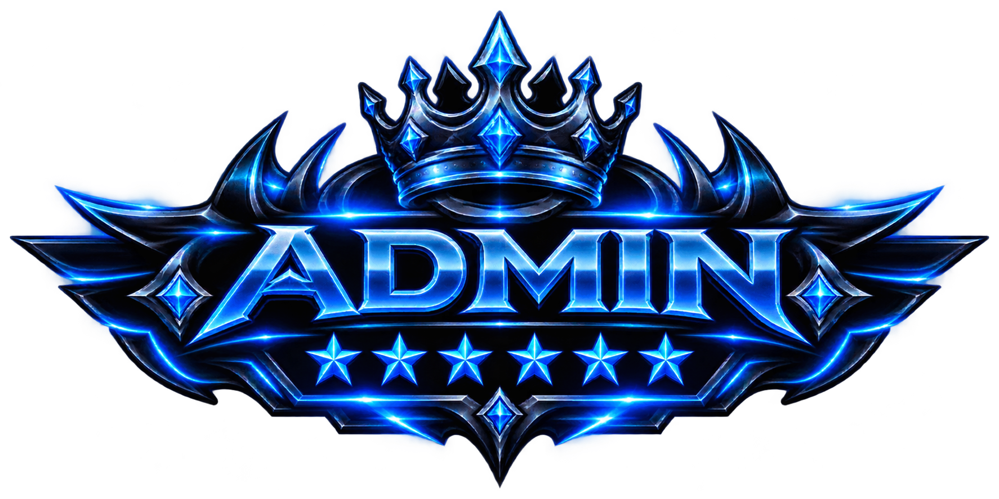

<html lang="id">
<head>
<meta charset="UTF-8">
<meta name="viewport" content="width=device-width, initial-scale=1.0">
<meta name="theme-color" content="#080912">
<title>HACKER CENTER — Cyber Intelligence Forum</title>

</head>
<body>

<header class="topbar">
  

HC

HACKER CENTER

THE HACKING FORUM

  

<i class="live-dot"></i> SYSTEM ONLINE

LZ

</header>
<section class="hero">
  
INDEPENDENT FORUM COMMUNITY / EST. 2026

  <h1>HACKER CENTER</h1>
  
Research, share, and strengthen digital infrastructure. A focused space for security notes, responsible disclosure, threat intelligence, and defensive engineering.

  

HC

</section>

  

WALLET / BTC BALANCE

0,002969 <small>BTC</small>

Read-only payment privat account

<button class="icon-btn balance-toggle" id="toggleBalance" aria-label="Hide balance"><svg viewBox="0 0 24 24" aria-hidden="true"><path d="M2.5 12s3.4-6 9.5-6 9.5 6 9.5 6-3.4 6-9.5 6-9.5-6-9.5-6Z"/><circle cx="12" cy="12" r="2.7"/></svg></button>

  
RANDOM MEMBER IDENTIFIER<strong id="randomId">HC-7A92-F04C</strong>

◆ MARKET THE HACK'S FORUM◆ RESPONSIBLE DISCLOSURE◆ DEFEND • RESEARCH • SHARE◆ MARKET THE HACK'S FORUM◆ RESPONSIBLE DISCLOSURE◆ DEFEND • RESEARCH • SHARE

<small>HACKER CENTER / FIELD NOTES</small><h2>BUILD KNOWLEDGE. EXPOSURE.</h2>
Practical security research, responsibly shared.

  

<b>SECURITY RESEARCH</b>ANALYSIS · HARDENING · REPORTS

  

<b>COMMUNITY EXCHANGE</b>TOOLS · KNOWLEDGE · COLLABORATION

<aside class="sidebar">
  
WORKSPACE

  <button class="nav-btn active" data-page="home"><svg viewBox="0 0 24 24"><path d="m3 10 9-7 9 7v10a1 1 0 0 1-1 1h-5v-7H9v7H4a1 1 0 0 1-1-1z"/></svg>Dashboard</button>
  <button class="nav-btn" data-page="threads"><svg viewBox="0 0 24 24"><path d="M4 5h16v12H8l-4 4zM8 9h8M8 13h5"/></svg>General 04</button>
  <button class="nav-btn" data-page="research"><svg viewBox="0 0 24 24"><path d="M4 5h16v14H4zM8 9h8M8 13h8M8 17h4"/></svg>Research Lab</button>
  <button class="nav-btn" data-page="market"><svg viewBox="0 0 24 24"><path d="M3 8h18l-2 12H5zM7 8l2-5h6l2 5M9 12v4M15 12v4"/></svg>Marketplace SAFE</button>
  <button class="nav-btn" data-page="members"><svg viewBox="0 0 24 24"><path d="M16 21v-2a4 4 0 0 0-4-4H6a4 4 0 0 0-4 4v2M9 11a4 4 0 1 0 0-8 4 4 0 0 0 0 8zM20 8v6M23 11h-6"/></svg>Members</button>
  
PERSONAL

  <button class="nav-btn" data-page="profile"><svg viewBox="0 0 24 24"><circle cx="12" cy="8" r="4"/><path d="M4 21a8 8 0 0 1 16 0"/></svg>Profile</button>
  <button class="nav-btn" data-page="compose"><svg viewBox="0 0 24 24"><path d="M12 5v14M5 12h14"/></svg>New thread</button>
  <button class="nav-btn" data-page="settings"><svg viewBox="0 0 24 24"><circle cx="12" cy="12" r="3"/><path d="m19.4 15 .1.1 1.4 1.1-1.4 2.4-1.7-.6a8 8 0 0 1-1.7 1l-.3 1.8h-2.8l-.3-1.8a8 8 0 0 1-1.7-1l-1.7.6-1.4-2.4L5.3 15a8 8 0 0 1 0-2l-1.4-1.1 1.4-2.4 1.7.6a8 8 0 0 1 1.7-1L9 7.3h2.8l.3 1.8a8 8 0 0 1 1.7 1l1.7-.6 1.4 2.4-1.4 1.1a8 8 0 0 1-.1 2z"/></svg>Settings</button>
  

<b id="sideName">L0ZXX</b><small id="sideRole">OWNER ACCOUNT</small>

</aside>
<main class="content">
  

<h3>Welcome back, L0ZXX!</h3>
You are signed in to the Hacker Center community workspace.

MEMBER ID <b id="welcomeId">HC-7A92-F04C</b> SESSION · LOCAL DEMO

  <section class="page active" id="page-home">
    

<h2>Temporary Announcement</h2>
Community standards and important updates

NOTICE BOARD

    

      

<svg viewBox="0 0 24 24"><path d="M3 11v2l13 5V6zM16 9a4 4 0 0 1 0 6M6 14l2 6h4l-2-5"/></svg>

<b>Share research responsibly</b>
Never publish personal information, credentials, private records, or unredacted breach data.

      

<svg viewBox="0 0 24 24"><path d="M12 3 3 7v5c0 5 4 8 9 9 5-1 9-4 9-9V7zM8 12l3 3 5-6"/></svg>

<b>Follow the disclosure policy</b>
Use coordinated disclosure and contact the system owner through an authorized channel.

      

<svg viewBox="0 0 24 24"><path d="M4 4h16v16H4zM8 8h8M8 12h8M8 16h5"/></svg>

<b>Keep uploads sanitized</b>
Remove secrets, personal identifiers, tokens, and live exploit payloads before attaching files.

    

    

<h2>Hacker Center — General</h2>
Explore the community categories

OPEN CHANNELS

    

      

<svg viewBox="0 0 24 24"><ellipse cx="12" cy="5" rx="8" ry="3"/><path d="M4 5v14c0 1.7 3.6 3 8 3s8-1.3 8-3V5M4 12c0 1.7 3.6 3 8 3s8-1.3 8-3"/></svg>

<b>Security Research</b>
Defensive analysis, vulnerability notes, and remediation.
<small>BY COMMUNITY</small>

      

<svg viewBox="0 0 24 24"><path d="M4 5h16v12H8l-4 4zM8 9h8M8 13h5"/></svg>

<b>General Discussion</b>
Ask questions and exchange practical knowledge.
<small>BY COMMUNITY</small>

      

<svg viewBox="0 0 24 24"><path d="M4 5h16v14H4zM8 9h8M8 13h5"/></svg>

<b>Tools & Resources</b>
Share legal tools, learning resources, and templates.
<small>CURATED EXCHANGE</small>

      

<svg viewBox="0 0 24 24"><circle cx="9" cy="8" r="4"/><path d="M2 21a7 7 0 0 1 14 0M17 4a4 4 0 0 1 0 8M18 15a6 6 0 0 1 4 6"/></svg>

<b>Community Members</b>
Meet contributors, moderators, and admins.
<small>1,200 DIRECTORY SLOTS</small>

    

    

<small>COMMUNITY FORUM</small><h3>Discussions live in General</h3>
Open the full thread index to read posts with author profiles, role emblems, biographies, statistics, and attachments.

<button class="action secondary" data-go="threads">Open General ↗</button>

  </section>

  <section class="page" id="page-threads">
    

<h2>General / Threads</h2>
Full discussion feed · author profile and attachments included

<button class="action" data-go="compose">＋ New thread</button>

    
<input class="search" id="threadSearch" placeholder="Search title, author, or topic…"><select class="search" id="threadFilter" style="max-width:145px"><option value="all">All categories</option><option>Security Research</option><option>General</option><option>Tools & Resources</option></select>

    

  </section>

  <section class="page" id="page-detail">
    

<h2>Thread / Full view</h2>
Complete post with author profile and attached material

<button class="action secondary" data-go="threads">← Back to General</button>

    

  </section>
  <section class="page" id="page-research">
    

<h2>Research Lab</h2>
Defensive knowledge base and responsible disclosure notes

DEFENSIVE ONLY

    

      

<svg viewBox="0 0 48 48" aria-hidden="true"><path d="M24 5.5 39 14v20L24 42.5 9 34V14L24 5.5Z"/><path d="m24 11 9.5 5.4v15.2L24 37l-9.5-5.4V16.4L24 11Z"/><path d="m18.5 20 5.5-3.1 5.5 3.1v8l-5.5 3.1-5.5-3.1v-8Z"/></svg>

<b>Asset Inventory</b>
Document systems you own or are authorized to assess.

      

<svg viewBox="0 0 48 48" aria-hidden="true"><path d="M24 5 38 10.5V22c0 9.2-5.5 16.2-14 21-8.5-4.8-14-11.8-14-21V10.5L24 5Z"/><path d="m17.5 23.5 4.3 4.3 9-10"/><path d="M17 13.5h14"/></svg>

<b>Hardening Notes</b>
Configuration baselines, patching, and access control.

      

<svg viewBox="0 0 48 48" aria-hidden="true"><circle cx="24" cy="24" r="15"/><circle cx="24" cy="24" r="8"/><path d="M24 3v8M24 37v8M3 24h8M37 24h8"/><path d="m20 24 2.7 2.7 5.8-6"/></svg>

<b>Incident Response</b>
Containment, recovery, and lessons learned.

      

<svg viewBox="0 0 48 48" aria-hidden="true"><path d="M8 8.5h32v25H22l-9 7v-7H8v-25Z"/><path d="M15.5 16.5h17M15.5 22.5h12"/><path d="m27.5 29 3 3 6-7"/></svg>

<b>Disclosure Reports</b>
Sanitized findings with clear remediation guidance.

    

    

<h2>Research discussions</h2>
Posts tagged Security Research

  </section>

  <section class="page" id="page-market">
    

<h2>Marketplace / Resource Exchange</h2>
Legal tools, templates, training, and defensive resources — no stolen data or personal records.

SAFE EXCHANGE

    

<svg viewBox="0 0 48 48" aria-hidden="true"><circle cx="24" cy="24" r="15"/><circle cx="24" cy="24" r="8"/><path d="M24 3v8M24 37v8M3 24h8M37 24h8"/><path d="m20 24 2.7 2.7 5.8-6"/></svg>

<b>Marketplace policy</b>
Only list resources you own or have permission to distribute. No credentials, breached databases, doxxing material, malware, or unauthorized access.

    
<input class="search" id="marketSearch" placeholder="Search tools and resources…"><button class="action" data-go="compose">＋ Share resource</button>

    

  </section>

  <section class="page" id="page-members">
    

<h2>Member Directory</h2>
Community roster · sample directory with 1,200 generated display identities

1,200 MEMBERS

    
<input class="search" id="memberSearch" placeholder="Find a member…"><select class="search" id="memberRole" style="max-width:140px"><option value="all">All roles</option><option>OWNER</option><option>MODERATOR</option><option>ADMIN</option><option>MEMBER</option></select>

    

<small>TOTAL MEMBERS</small><b>1,200</b>

<small>ONLINE NOW</small><b>84</b>

<small>STAFF TEAM</small><b>16</b>

    

  </section>

  <section class="page" id="page-profile">
    

<h2>Member Profile</h2>
Public profile preview and account statistics

<button class="profile-more" type="button" aria-label="Open profile settings menu" title="Profile settings" id="profileMore"><svg viewBox="0 0 24 24"><circle cx="5" cy="12" r="1.5"/><circle cx="12" cy="12" r="1.5"/><circle cx="19" cy="12" r="1.5"/></svg></button><button class="action" data-go="settings">Edit profile</button>

    

      

LZ
<h3 id="profileName">L0ZXX</h3>
OWNER

Security enthusiast · defensive research · responsible disclosure.

<b id="myPosts">0</b><small>POSTS</small>

<b>18</b><small>THREADS</small>

<b>2026</b><small>JOINED</small>

      

<h2>Account statistics</h2>
Local prototype metrics

<small>MEMBER ID</small><b style="font-size:15px" id="profileId">HC-7A92-F04C</b>

<small>REPUTATION</small><b>98%</b>

<small>STATUS</small><b style="color:var(--green)">ACTIVE</b>

<label>ABOUT THIS PROFILE</label>
Security enthusiast · defensive research · responsible disclosure.

<button class="action" data-go="settings">Manage profile →</button>

    

  </section>

  <section class="page" id="page-compose">
    

<h2>Create a thread</h2>
Publish a discussion, sanitized report, or community resource

NEW POST

    

      <form id="postForm">
        
<label for="postTitle">THREAD TITLE</label><input id="postTitle" maxlength="120" required placeholder="Write a clear, descriptive title…">

        

<label for="postCategory">CATEGORY</label><select id="postCategory"><option>General</option><option>Security Research</option><option>Tools & Resources</option></select>

<label for="postType">POST TYPE</label><select id="postType"><option>Discussion</option><option>Research Note</option><option>Resource Listing</option><option>Responsible Disclosure</option></select>

        
<label for="postBody">DESCRIPTION / BODY</label><textarea id="postBody" required placeholder="Explain the context, findings, defensive impact, and recommended mitigation…"></textarea><small>Do not include personal data, passwords, access tokens, private records, or instructions for unauthorized access.</small>

        

<label for="postImage">ATTACH IMAGE</label><input class="file-pick" id="postImage" type="file" accept="image/*"><small>Image preview is stored locally in this browser.</small>

<label for="postFile">ATTACH FILE</label><input class="file-pick" id="postFile" type="file"><small>Only attach sanitized files you have permission to share.</small>

        

✓

<b>Publishing checklist</b>
Confirm that this post contains no doxxing, exposed credentials, stolen datasets, or private personal information.

        <label style="display:flex;gap:9px;align-items:flex-start;font-size:10px;color:#bdb9d1;margin:10px 0 16px"><input type="checkbox" id="safeConfirm" required style="accent-color:#a77cff;margin-top:1px"> I confirm this content is authorized, sanitized, and safe to share.</label>
        <button class="action" type="submit">Publish thread →</button> <button class="action secondary" type="reset">Clear form</button>
      </form>
    

  </section>

  <section class="page" id="page-settings">
    

<h2>Profile & Settings</h2>
Customize your local demo identity and role preview

LOCAL SETTINGS

    

      <form id="profileForm">
        

          
LZ

          
<strong id="settingsNamePreview">L0ZXX</strong><small id="settingsRolePreview">OWNER · PROFILE PREVIEW</small>

          
        

        

<label for="editName">DISPLAY NAME</label><input id="editName" maxlength="22" required value="L0ZXX">

<label for="editRole">ROLE BADGE</label><select id="editRole"><option>OWNER</option><option>MODERATOR</option><option>ADMIN</option><option>MEMBER</option></select><small>Role switching is a visual prototype only; it does not grant real privileges.</small>

        
<label for="editBio">BIO</label><textarea id="editBio" maxlength="240">Security enthusiast · defensive research · responsible disclosure.</textarea>

        
<label for="editAvatar">PROFILE IMAGE</label><input class="file-pick" id="editAvatar" type="file" accept="image/*"><small>Choose a square image for best results.</small>

        <button class="action" type="submit">Save profile settings</button>
      </form>
    

    

<h2>Role emblem mapping</h2>
Place the corresponding PNG files beside this HTML file.

    

      

<b class="gold-text">OWNER</b>
o2.png · gold accent

      

<b>MODERATOR</b>
m2.png · teal accent

      

<b>ADMIN</b>
a2.png · violet accent

      

<b>MEMBER</b>
mb2.png · neutral accent

    

  </section>
  <footer class="footer">HACKER CENTER · CYBER INTELLIGENCE NETWORK · LOCAL FRONT-END DEMO</footer>
</main>

<h3>Thread preview</h3><button class="close" id="closeModal">×</button>

</body>
</html>
